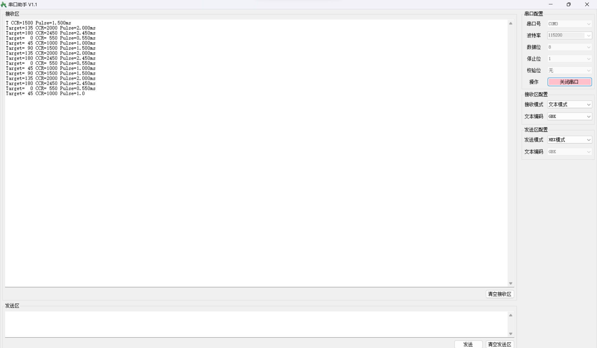

# RM-2027 电控培训 · 作业四：PWM 驱动 SG90 舵机

> 姓名：陈金泽
> 日期：2026-11-23

> 关于仓库名：任务书要求仓库名为「RM-2027-电控培训-作业-姓名」，但 GitHub 仓库名只接受
> ASCII 字母、数字和 `. , - _`，中文会被服务端逐个替换成 `-`（实测建库后名为 `RM-2027------`）。
> 故仓库名取 `RM2027-EC-HW4`，中文全名写在本题名里。

## 一、任务

用 PWM 驱动一只 SG90（180° 型）舵机，按 `0° → 45° → 90° → 135° → 180°` 的序列循环转动；
同时把「目标角度 / CCR 值 / 脉宽」三行信息显示在 OLED 上，并通过串口打印同样的内容。

## 二、硬件连接

| 功能 | 引脚 | 说明 |
|---|---|---|
| SG90 PWM 信号 | PA0 | TIM2_CH1，50 Hz |
| 舵机 VCC | 外部 5 V | **不要从板子取电** |
| 舵机 GND | 与板子共地 | 共地不可省 |
| OLED SCL | PB8 | 软件 I²C，开漏输出 + 上拉 |
| OLED SDA | PB9 | 软件 I²C，开漏输出 + 上拉 |
| 串口 TX | PA9 | USART1_TX → CH340 RXD |
| 串口 RX | PA10 | USART1_RX → CH340 TXD |
| 串口 GND | 与 CH340 共地 | |

## 三、时钟树

- HSE 外部晶振 8 MHz
- PLL ×9 → **SYSCLK 72 MHz**
- AHB 不分频 → HCLK 72 MHz
- APB1 二分频 → PCLK1 36 MHz
- APB2 不分频 → PCLK2 72 MHz

## 四、PWM 参数推导（PSC / ARR）

### 4.1 定时器时钟是多少？

TIM2 挂在 **APB1** 上。按上面时钟树，PCLK1 = 36 MHz。

当 APB1 上的预分频器不为 1 时，定时器时钟会被硬件强行乘以 2，所以 PCLK1 = 36 MHz，定时器时钟为 36 × 2 = 72 MHz。

### 4.2 PSC 怎么取？

```c
htim2.Init.Prescaler = 72 - 1;   // tim.c:44
```
由公式 `定时器周期 = (PSC+1) × (ARR+1) / 定时器时钟`，可知应让 PSC = 72-1 来抵消 72e6 的 72。

计数频率 = 定时器时钟 / (PSC+1) = 72 MHz / 72 = 1 MHz，即 1 个 tick = 1 μs。
取 1 MHz 是为了让 CCR 直接等于微秒数，`CCR = 1500` 就是 1.5 ms，换算时不用再绕一层。

### 4.3 ARR 怎么取？

```c
htim2.Init.Period = 20000 - 1;   // tim.c:46
```
周期 = (ARR+1) × 1 tick = 20000 × 1 μs = 20 ms，对应 50 Hz。
50 Hz 是传统模拟舵机的标准信号频率，舵机内部靠这个周期的重复来维持位置。

### 4.4 角度换算与限位

```c
uint16_t AngleToCCR(float angle)
{
  if (angle < 0.0f)   angle = 0.0f;
  if (angle > 180.0f) angle = 180.0f;

  uint16_t ccr = (uint16_t)(500.0f + angle / 180.0f * 2000.0f);

  if (ccr < 550)  ccr = 550;
  if (ccr > 2450) ccr = 2450;

  return ccr;
}
```
0.5 ms ↔ 0°、2.5 ms ↔ 180° 是名义值。实际 SG90 的行程比标称窄，所以两端各留 50 μs 余量：下限 500 → 550，上限 2500 → 2450。

如果不收这 50 μs，舵机会打满名义区间，顶住内部限位机构并持续堵转，电流升高、线圈发热，时间长了会烧。宁可少转 5°，也不能让它顶死。

另外，舵机认的是**脉宽**（高电平持续多久），不是占空比。占空比只是脉宽除以周期的结果：`550/20000 = 2.75%`、`2450/20000 = 12.25%`。所以频率一变，脉宽不能跟着变，否则同一个占空比就指向完全不同的角度。

实测对照表：

| 角度 | CCR | 脉宽 |
|---|---|---|
| 0° | 550 | 0.550 ms |
| 45° | 1000 | 1.000 ms |
| 90° | 1500 | 1.500 ms |
| 135° | 2000 | 2.000 ms |
| 180° | 2450 | 2.450 ms |

## 五、代码结构

| 文件 | 作用 |
|---|---|
| `Core/Src/main.c:107-118` | 主循环跑五个角度的序列，每个点停 1 s |
| `Core/Src/main.c:164-176` | `AngleToCCR()`：角度 → 比较值，含两端限位 |
| `Core/Src/main.c:177-181` | `Servo_SetAngle()`：写 TIM2_CH1 的比较寄存器 |
| `Core/Src/main.c:182-186` | `_write()`：GCC 下 printf 的重定向 |
| `Core/Src/main.c:188-207` | `OLED_ShowAll()`：三行显示 |
| `Core/Src/OLED.c` | OLED 软件 I²C 驱动 |
| `Core/Src/tim.c` | TIM2 初始化（PSC / ARR / PWM 模式） |

## 六、串口输出

- 端口 COM3，**115200 8N1**
- `printf` 经 `_write` 走 USART1（阻塞发送）

实测输出：

```
Target=135 CCR=2000 Pulse=2.000ms
Target=180 CCR=2450 Pulse=2.450ms
Target=  0 CCR= 550 Pulse=0.550ms
Target= 45 CCR=1000 Pulse=1.000ms
Target= 90 CCR=1500 Pulse=1.500ms
```



### 关于实测周期 1.73 s

序列里每个点写的是 `HAL_Delay(1000)`，但实测相邻两条输出间隔 **1.73 s**。
多出来的时间花在 `OLED_ShowAll()` 上：软件 I²C 刷整屏要几十毫秒，加上 printf 的阻塞发送和循环开销。

这说明 `HAL_Delay()` 期间 CPU 是**空转**的，真要做多任务就得换成定时器中断 + 状态机。

## 七、演示视频

`docs/hw4_demo.mp4`（13 秒，720×1280，H.264）

一镜到底，舵机与 OLED 始终同画面。片中依次跑过 `0° → 45° → 90° → 135° → 180°` 五个点，
其中 `180° / CCR 2450 / 2.450 ms` 清晰可见，舵机臂同步转到对应位置，OLED 三行随角度实时刷新。

## 八、编译资源占用

```
text     data     bss     dec
19968     104    2048   22120
```

- **RAM**：`data 104 + bss 2048 = 2152 B / 20480 B = 10.51 %`
- **FLASH**：`text 19968 + data 104 = 20072 B / 65536 B = 30.63 %`
- error 0 / warning 0

## 九、如何编译与烧录

```powershell
$env:PATH = "F:\STM32CLT\STM32CubeCLT_1.22.0\GNU-tools-for-STM32\bin;F:\STM32CLT\STM32CubeCLT_1.22.0\CMake\bin;F:\STM32CLT\STM32CubeCLT_1.22.0\Ninja\bin;" + $env:PATH
cd F:\STM32\RM2027-EC-HW4
cmake --preset Debug
cmake --build build/Debug
```

烧录用 STM32CubeProgrammer CLI，`-c port=SWD mode=UR -w <elf> -v -rst`。

## 十、目录说明

- `Core/`、`Drivers/`、`cmake/`：工程源码
- `RM2027-EC-HW4.ioc`：CubeMX 配置，别人靠它复现配置
- `docs/`：串口截图 `uart.png`、演示视频 `hw4_demo.mp4`
- `build/`、`.idea/`：本机中间产物，**不进仓库**